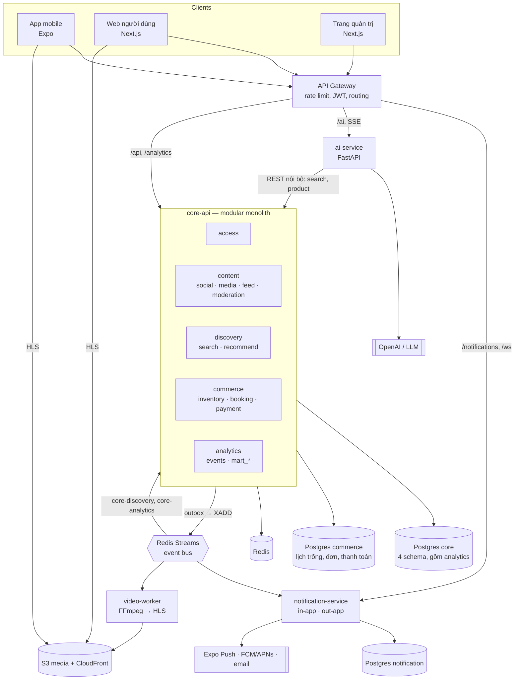
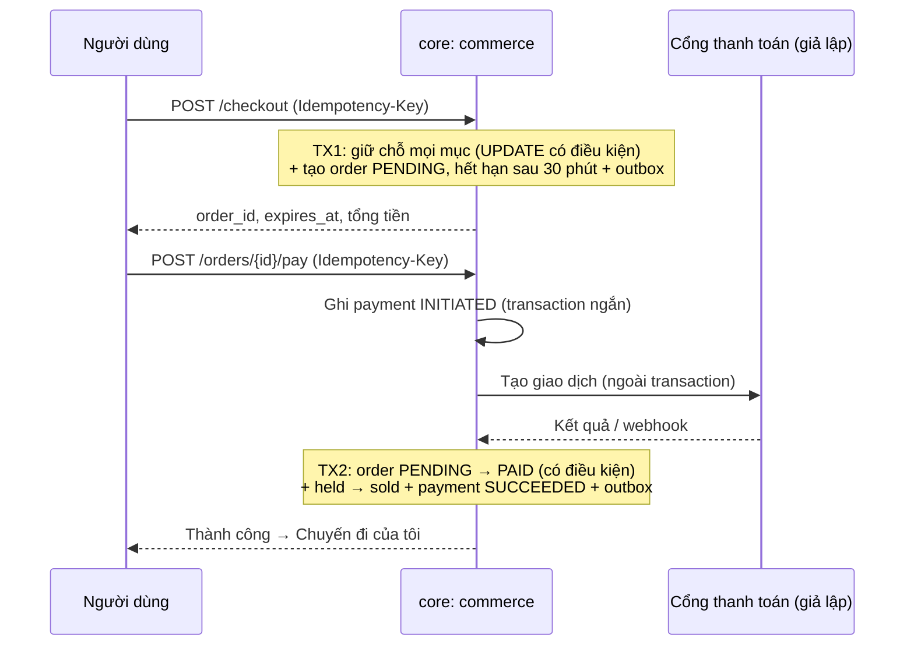

# Đề xuất kiến trúc hệ thống và cấu trúc repo — Tripflix

**Phiên bản:** 0.6 · **Ngày:** 2026-11-04 · **Trạng thái:** Đề xuất, chờ Tech Lead chốt · **Người đọc:** cả team kỹ thuật

> Tóm tắt: giữ **3 repo** (FE, BE, AI). Backend gồm `core-api` (modular monolith, **5 module, mỗi module 1 schema; 2 database: `core` và `commerce`**, trong đó module `analytics` giữ kho sự kiện tập trung), `notification-service` (chịu tải cao, scale riêng) và `video-worker`. AI là service riêng, không giữ dữ liệu nghiệp vụ. **Không còn Channel Manager:** OTA tự quản lý lịch trống và giá trong module `commerce` (database riêng), nên giữ chỗ, đặt và thanh toán chỉ cần **một transaction cục bộ**, không saga. Analytics là **module thứ 5 của `core-api`**, kho sự kiện là schema `analytics` trên Postgres, chưa cần data lake ở MVP.

### Thay đổi so với bản 0.1

| Bản 0.1 | Bản 0.2 | Lý do |
|---|---|---|
| 10–11 module nhỏ, mỗi module 1 schema, `booking` + `payment` dùng chung transaction dù khác schema | Gộp thành 4 module: `access`, `content`, `discovery`, `commerce` | Bản cũ vừa cấm query chéo schema vừa mở transaction chéo schema, tự mâu thuẫn. Gộp những phần luôn đổi cùng nhau thì transaction nằm gọn trong 1 module |
| Tồn kho ở `channel-manager-api` (database riêng), giữ chỗ bằng saga | Tồn kho vào `commerce`, bỏ CM và saga | Một database, một transaction; không cần bù trừ qua mạng |
| `notification` là module trong core | Tách `notification-service`, chia in-app và out-app | Nhận sự kiện từ mọi module, tải dồn theo đợt, cần scale ngang riêng |
| `analytics` đọc read model trong Postgres core | `analytics-service` đọc **kho sự kiện tập trung** (bản 0.4: Postgres `analytics` riêng; bản 0.5: trở lại làm module của `core-api`) | Mọi sự kiện đổ về một chỗ; truy vấn thống kê không làm chậm database nghiệp vụ |
| Transaction đặt ở chỗ nào cũng được | Transaction chỉ mở ở **use case** của một module, không giữ khi gọi dịch vụ ngoài | Xem mục 3.3 |

### Thay đổi ở bản 0.3

- Thêm `mock-channel-manager`: service mô phỏng, không database, chỉ cấp giá và tồn kho để `commerce` đồng bộ về (mục 3.11). Luồng đặt chỗ không đổi, vẫn không có saga. Thắng phụ trách cả mock lẫn `commerce` (adapter `SupplyProvider`, job đồng bộ).
- Sơ đồ [06-kien-truc-tong-quan](06-kien-truc-tong-quan.png) và [06-kien-truc-lop](06-kien-truc-lop.png) vẽ lại theo bản này (v4), có ô bọc gom các phần của từng module.
- Analytics chốt dùng data lake (S3 + Parquet + DuckDB); bỏ phương án OpenSearch khỏi danh sách cần chốt.

### Thay đổi ở bản 0.4

- Analytics không dùng DuckDB + Parquet nữa: kho sự kiện là **database Postgres riêng `analytics`** (bảng `events` chia partition theo ngày, bảng tổng hợp `mart_*` làm mới mỗi 5 phút). Lý do: bớt một công nghệ, cả nhóm đã quen Postgres, dư sức cho quy mô pilot. Data lake giữ làm hướng mở rộng qua interface `EventStoreWriter` (mục 3.6).
- `ai-service` nằm trong business layer, ngang hàng `core-api` (sơ đồ lớp docs/06 đã sửa).

### Thay đổi ở bản 0.5

- Bỏ `analytics-service`; analytics trở lại làm **module thứ 5 của `core-api`** (schema `analytics`, pool kết nối riêng). Lý do: đã dùng Postgres nên không còn khác công nghệ, bớt một service phải dựng. Ranh giới giữ nguyên: chỉ nhận dữ liệu qua sự kiện, chỉ đọc bảng của mình; tách lại thành service khi tải thống kê ảnh hưởng core (mục 3.6, mục 8).
- Còn 3 service ngoài `core-api`: `notification-service`, `video-worker`, `ai-service`.

### Thay đổi ở bản 0.6 (Thắng chỉnh phần commerce)

- **Bỏ `mock-channel-manager`**: OTA tự quản lý lịch trống và giá; job 6 giờ/lần mở thêm lịch trống cho đủ 180 ngày tới; superadmin sửa giá, số phòng ở màn "Lịch trống & giá" (mục 3.11).
- `commerce` dùng **database Postgres riêng** (dữ liệu giả lập, seed lại được); `core-api` kết nối 2 database.
- Giữ chỗ **30 phút** (trước là 10 phút).
- `payment` thêm **đối soát** và **hoàn, huỷ**.

---

## 1. Bối cảnh và ràng buộc

| Ràng buộc | Ảnh hưởng tới kiến trúc |
|---|---|
| 7 người, pilot 4 tuần, demo sớm | Mỗi service tách thêm là thêm CI, Dockerfile, deploy, xử lý lỗi mạng. Chỉ tách khi có lý do về tải hoặc công nghệ. |
| F5/F6: giữ chỗ 30 phút, không bán trùng, không trừ tiền hai lần | Tồn kho, đơn hàng và giao dịch thanh toán phải cùng một module, cùng một database để dùng transaction thật. |
| MVP không tích hợp channel manager; giá, lịch trống là dữ liệu giả lập | `commerce` tự quản lý lịch trống và giá trong database riêng (mục 3.11). Khi có đối tác thật thì thêm adapter nhập dữ liệu, không đổi kiến trúc. |
| Điểm nghẽn là video (HLS, S3 + CloudFront) | Transcode chạy ở `video-worker`, tách tiến trình để không kéo chậm API. |
| Thông báo đến từ nhiều nguồn (bình luận, thích, đơn hàng, kiểm duyệt) và đến theo đợt | Thông báo là service riêng, nhận sự kiện qua Redis Streams, scale ngang theo số replica. |
| Bảng số liệu cần truy vấn trên toàn bộ sự kiện của mọi module | Đổ sự kiện về một kho tập trung (module `analytics`, schema `analytics`); thống kê chỉ đọc kho đó. |
| AI dùng Python, LLM bên ngoài, có bộ đánh giá 50 + 100 câu | Repo AI riêng bằng Python. |

## 2. Đánh giá phương án

| Phương án | Mô tả | Ưu | Nhược | Kết luận |
|---|---|---|---|---|
| A. Monolith thuần | 1 app, 1 database, không ranh giới | Nhanh nhất | Code dính nhau, khó chia việc cho 7 người | Loại |
| B. Modular monolith nhiều module nhỏ | 10 module, 10 schema | Ranh giới rõ trên giấy | Use case nào cũng chạm 2–3 module; phải chọn giữa transaction chéo schema (phá ranh giới) và saga (quá nặng) | Loại (bản 0.1) |
| **C. Modular monolith module lớn + vài service chuyên biệt** | `core-api` 5 module (gồm `analytics`); tách `notification`, `video-worker`, `ai` | Transaction nằm gọn trong 1 module; chỉ tách phần có tải hoặc công nghệ khác | Module `content` lớn, 3 người cùng làm, cần chia thư mục và review chặt | **Chọn** |
| D. Microservice đầy đủ | Mỗi module 1 service, 1 database | Scale độc lập từng phần | Saga khắp nơi; vượt sức 7 người trong 4 tuần | Loại cho MVP |

Nguyên tắc chia module: **những gì phải đổi cùng nhau trong một transaction thì ở cùng một module.** Nếu một use case cần transaction trải qua hai module, đó là dấu hiệu ranh giới chia sai: gộp hai module lại, không dùng transaction chéo, không dùng saga ([Milan Jovanović](https://milanjovanovic.tech/blog/modular-monolith-vs-microservices.md); [Martin Fowler — MonolithFirst](https://martinfowler.com/bliki/MonolithFirst.html)).

## 3. Kiến trúc đề xuất



### 3.1. Các deployable

| Deployable | Repo | Công nghệ | Sở hữu dữ liệu | Lý do tách |
|---|---|---|---|---|
| `core-api` | BE | NestJS | Postgres `core` (4 schema, gồm `analytics`) + Postgres `commerce` | Lõi nghiệp vụ và kho sự kiện |
| `notification-service` | BE | NestJS, BullMQ, Socket.IO | Postgres `notification` (database riêng) | Nhận sự kiện từ mọi module, tải theo đợt, scale ngang riêng |
| `video-worker` | BE | Node + FFmpeg | Không; ghi kết quả vào S3, báo về core bằng sự kiện | CPU nặng, scale riêng |
| `ai-service` | AI | Python, FastAPI | Không giữ dữ liệu nghiệp vụ | Ecosystem Python, vòng đánh giá riêng |
| `mobile`, `web`, `admin` | FE | Expo, Next.js | — | — |

`video-worker` và `notification-service` build từ cùng monorepo BE với `core-api` (dùng chung `libs/`), mỗi cái một entrypoint và một Dockerfile.

### 3.2. Năm module trong `core-api`

| Module (schema) | Gồm | Bảng chính | Transaction tiêu biểu nằm gọn trong module |
|---|---|---|---|
| `access` | Đăng ký, đăng nhập, phiên, vai trò | `users`, `sessions`, `password_resets`, `service_clients`, `audit_log` | Xoay vòng refresh token: thu hồi phiên cũ + tạo phiên mới |
| `content` | `social` (bài, bình luận, theo dõi, lưu), `media` (upload, bản HLS, ảnh bìa), `feed` (điểm xu hướng, bảng tin), `moderation` (luật, báo cáo, hàng chờ) | `posts`, `comments`, `reactions`, `follows`, `media_assets`, `renditions`, `trend_scores`, `reports`, `moderation_actions` | Ẩn bài: đổi trạng thái bài + ghi `moderation_actions` + loại khỏi `trend_scores` + ghi outbox, cùng lúc |
| `discovery` | `search` (bài đăng, khách sạn, vé), `recommend` (gợi ý bài, gợi ý mục còn thiếu ở bước xác nhận) | `search_documents` (`tsvector`, `pgvector`), `interaction_signals`, `recommendation_cache` | Cập nhật chỉ mục của một tài liệu khi nhận sự kiện |
| `commerce` (**database riêng**) | `inventory` (khách sạn, loại phòng, chuyến bay, giá và lịch trống theo ngày, OTA tự quản lý), `booking` (đơn, mục, giữ chỗ 30 phút), `payment` (giao dịch giả lập, đối soát, hoàn huỷ) | `properties`, `room_types`, `room_inventory`, `room_rates`, `flights`, `flight_inventory`, `orders`, `order_items`, `payments`, `refunds` | Checkout: giữ tất cả mục + tạo đơn, cùng một transaction (mục 3.4) |
| `analytics` | Kho sự kiện tập trung, bảng tổng hợp, API số liệu cho trang quản trị (mục 3.6) | `events` (chia partition theo ngày), `snapshot_*`, `mart_*` | Ghi một lô sự kiện, bỏ qua `event_id` trùng; làm mới một bảng `mart_*` |

Bên trong mỗi module vẫn chia thư mục con theo phần (`content/social`, `content/feed`…) để nhiều người làm song song, nhưng các phần con **dùng chung schema và được join, đặt khoá ngoại với nhau**.

Quy tắc giữa các module:

1. **Không query chéo schema, không transaction chéo module.** Module A không đọc hay ghi bảng của module B.
2. Cần **đọc** dữ liệu của module khác: gọi public interface của module đó (export từ `index.ts`, gọi trong tiến trình, không qua HTTP). Ví dụ `discovery` gọi `content.getVisiblePosts(ids)` và `commerce.checkAvailability(ids, dates)`.
3. Cần **phản ứng** với thay đổi của module khác: nghe sự kiện (ví dụ `content.post.hidden`, `commerce.order.paid`). Không ghi sang module khác trong cùng transaction.
4. Nếu một use case buộc phải ghi hai module cùng lúc mới đúng, gộp hai module đó lại; không thêm saga.

### 3.3. Transaction đặt ở đâu

| Quy tắc | Cách làm |
|---|---|
| Ranh giới transaction là **một use case** trong lớp `application/` của một module (ví dụ `CheckoutUseCase`, `HidePostUseCase`) | Controller không mở transaction. Repository không tự mở transaction riêng. |
| Các repository trong use case dùng chung transaction đang mở | `@nestjs-cls/transactional` với adapter Prisma (hoặc Drizzle): đánh dấu `@Transactional()` ở use case, repository lấy transaction từ context. |
| **Không giữ transaction trong lúc gọi ra ngoài** (cổng thanh toán, AI kiểm duyệt, S3, gửi thông báo) | Gọi ra ngoài trước hoặc sau transaction; nối các bước bằng trạng thái của bản ghi (`PENDING → PAID`), không bằng transaction dài. |
| Sự kiện ghi vào bảng `outbox` của module **trong cùng transaction** với thay đổi | Relay đọc outbox, `XADD` sang Redis Streams. Thay đổi rollback thì sự kiện cũng không phát. |
| Chống tranh chấp tồn kho bằng **cập nhật có điều kiện**, không khoá cả bảng | `UPDATE ... WHERE total - held - sold >= :qty`, kiểm số dòng bị cập nhật. |
| Mọi lệnh ghi có thể bị gửi lại đều có `Idempotency-Key` | Bảng `idempotency_keys` (unique), lưu kết quả lần đầu để trả lại. |

### 3.4. Luồng "Đặt theo lộ trình" (một module, không saga)



- **TX1** giữ tất cả mục trong một transaction: thiếu một mục thì rollback, không giữ gì, trả về mục bị thiếu. Không còn trường hợp "đã giữ một phần".

  ```sql
  UPDATE commerce.room_inventory
  SET held = held + :qty
  WHERE room_type_id = :rt AND date BETWEEN :checkin AND :checkout - 1
    AND total - held - sold >= :qty;
  -- số dòng cập nhật phải bằng số đêm, nếu không thì ROLLBACK
  ```

- **TX2** chỉ chạy nếu đơn còn `PENDING`: `UPDATE orders SET status = 'PAID' WHERE id = :id AND status = 'PENDING'`. Nếu 0 dòng (đơn đã hết hạn trong lúc trả tiền) thì ghi hoàn tiền tự động và báo người dùng.
- **Job hết hạn** chạy mỗi phút, mỗi đơn quá hạn là một transaction: `PENDING → EXPIRED`, trả `held`, phát `commerce.order.expired`.
- Mất mạng giữa chừng: gửi lại cùng `Idempotency-Key` thì nhận lại đúng kết quả cũ, không giữ thêm chỗ, không trừ tiền lần hai.

### 3.5. `notification-service`: in-app và out-app

| | In-app | Out-app |
|---|---|---|
| Là gì | Hộp thông báo trong app, chấm đỏ, số đếm realtime (thích, bình luận) | Push lên điện thoại khi app đóng; email (xác nhận đơn, đặt lại mật khẩu) |
| Lưu ở đâu | Bảng `inbox` trong Postgres `notification` | Bảng `deliveries` (trạng thái gửi, số lần thử) |
| Đường đi | WebSocket (Socket.IO, adapter Redis để nhiều replica cùng phát) | BullMQ: hàng đợi riêng cho `push` và `email`, thử lại có giới hạn |
| Nhà cung cấp | — | Expo Push (đi qua FCM/APNs), email qua Amazon SES |

**Chịu tải cao khi dữ liệu đổ về từ nhiều module:**

- Nhận sự kiện từ Redis Streams bằng **consumer group** `notification`: chạy N replica thì sự kiện tự chia đều; tăng tải thì tăng replica, không phải sửa code.
- **Sự kiện mang sẵn dữ liệu cần dùng** (người nhận, tên người gửi, tiêu đề bài, ảnh bìa), nên service không phải gọi ngược về core mỗi lần gửi và không kéo core chậm theo.
- **Gom thông báo:** nhiều lượt thích cùng một bài trong 1–2 phút thì gộp thành một thông báo ("Lan và 11 người khác thích bài của bạn").
- Tôn trọng tuỳ chọn người dùng: tắt từng loại, giờ im lặng; có giới hạn số push mỗi người mỗi giờ.
- Idempotent theo `event_id`; push lỗi thì thử lại có giãn cách, quá 5 lần thì vào hàng lỗi để xem tay.
- Core không bao giờ chờ thông báo: core chỉ ghi outbox. `notification-service` sập thì đặt chỗ, đăng bài vẫn chạy, thông báo đến muộn khi service lên lại.

### 3.6. Module `analytics` và kho sự kiện

**Mục tiêu:** mọi sự kiện của mọi module đổ về **một chỗ**; bảng số liệu (A15, A16, B7, chỉ số mục 9) chỉ đọc chỗ đó, không đọc bảng nghiệp vụ của module khác. Ở MVP "một chỗ" là **schema `analytics` trong Postgres `core`**, do module thứ 5 của `core-api` sở hữu.

| Phần | Cách làm (MVP) |
|---|---|
| Nguồn | (1) Sự kiện nghiệp vụ từ outbox của các module qua Redis Streams. (2) Sự kiện hành vi từ app (xem, thời gian xem, lướt qua, số đo `metric`) gửi lên `POST /events` theo lô, có rate limit; endpoint chỉ đẩy vào `stream:app-events`. (3) Chi phí AI (`ai.usage.recorded`). (4) Bản chụp hằng đêm danh mục bài, sản phẩm, lấy qua public interface của `content`, `commerce`, đã bỏ thông tin cá nhân. |
| Nạp | Module `analytics` nghe mọi stream bằng consumer group `core-analytics`, gom lô (1–5 giây hoặc 1.000 sự kiện) rồi `INSERT` nhiều dòng một lần vào `analytics.events`. Idempotent theo `event_id` (`ON CONFLICT DO NOTHING`). |
| Bảng thô | `events(event_id, type, occurred_at, user_id, payload jsonb)`, **chia partition theo ngày**, index BRIN theo `occurred_at`. Bản chụp danh mục vào `snapshot_*`. |
| Tổng hợp | Job 5 phút làm mới các bảng tổng hợp `mart_*` (lượt xem theo bài, tỉ lệ từ bài sang đặt chỗ, chi phí AI theo ngày, p50 và p95 số đo bằng `percentile_cont`…). |
| Truy vấn | API `/analytics/*` của `core-api` (chỉ superadmin, moderator) chỉ đọc `mart_*`, không quét bảng thô, trả kết quả trong vài trăm mili giây. |
| Dọn dữ liệu | Giữ bảng thô 90 ngày: xoá cả partition cũ (`DROP` partition), không `DELETE` từng dòng. Bảng `mart_*` giữ lâu dài. |
| Dữ liệu cá nhân | Chỉ giữ `user_id`, không giữ email, số điện thoại, thông tin thanh toán. |
| Độ trễ | Số liệu trễ tối đa khoảng 5 phút, trang quản trị hiện "cập nhật lúc …". Số cần tức thời (hàng chờ kiểm duyệt, đơn) gọi thẳng `content`, `commerce`. |

**Không làm chậm phần đặt chỗ:**

- Module `analytics` dùng **pool kết nối riêng** (giới hạn số kết nối), nên truy vấn thống kê không chiếm hết kết nối của `commerce`.
- Job tổng hợp chạy 5 phút một lần trên bảng thô đã chia partition; API chỉ đọc `mart_*` nhỏ.
- Cấu hình kết nối của module trỏ được sang **database riêng** chỉ bằng biến môi trường, vì module không join với schema nào khác.

**Vì sao là module của `core-api`, không phải service riêng (bản 0.5):** sau khi chọn Postgres, analytics không còn khác công nghệ với core; ở quy mô pilot, thêm một service chỉ thêm Dockerfile, CI, deploy mà không được gì. Ranh giới vẫn giữ chặt: chỉ nhận dữ liệu qua sự kiện, chỉ đọc bảng của mình. Khi thống kê bắt đầu ảnh hưởng `core-api`, tách thành `analytics-service` chỉ là chuyển thư mục module sang app mới (mục 8).

**Vì sao chọn Postgres thay vì data lake (S3 + Parquet + DuckDB) hay OpenSearch ở MVP:**

| | Postgres, schema `analytics` (**đã chọn**) | Data lake S3 + Parquet + DuckDB | OpenSearch + Dashboards |
|---|---|---|---|
| Thêm công nghệ | Không: cùng Postgres, ORM, migration với các module khác | Phần ghi Parquet, bucket lake, DuckDB | Một cụm mới cần RAM, mapping, sao lưu |
| Hợp quy mô pilot | Dư sức (vài nghìn đến vài triệu sự kiện) | Dư sức | Dư sức |
| Truy vấn khi dữ liệu rất lớn | Chậm dần (lưu theo dòng) | Nhanh (lưu theo cột) | Nhanh với truy vấn tìm kiếm, tổng hợp |
| Bảng số liệu | Tự vẽ trong `admin` từ API; Grafana nối được nếu cần bảng nội bộ | Tự vẽ trong `admin` | Có sẵn Dashboards |

Code nạp chỉ phụ thuộc interface `EventStoreWriter`. Khi dữ liệu lớn tới mức Postgres chậm, đổi adapter ghi sang S3 + Parquet (lakehouse, đọc bằng DuckDB hoặc Athena/Trino); phần nhận sự kiện và API đọc giữ nguyên.

### 3.7. AI service

| Chức năng | Endpoint gợi ý | Ghi chú |
|---|---|---|
| Hiểu câu tìm kiếm kiểu người trẻ (F4) | `POST /parse-query` | Trả bộ lọc có cấu trúc: điểm đến, ngân sách, số người, "vibe". `discovery` dùng bộ lọc đó truy vấn PostgreSQL (full-text, `unaccent`, `pg_trgm`). |
| Trợ lý (F9) | `POST /chat` (SSE) | Gọi **tool** là API search của `discovery`; chỉ trả chỗ, bài có thật, đã lọc bài bị ẩn. Không đọc database trực tiếp. |
| Tóm tắt bài đăng (F11) | `POST /summarize` | Chỉ nhận dữ liệu core gửi sang. |
| Kiểm duyệt chữ và ảnh (F8) | `POST /moderate` | Bọc OpenAI omni-moderation + regex; `content` gọi khi đăng và sửa bài, **ngoài transaction**. |
| Embedding (nếu dùng tìm theo nghĩa) | `POST /embed` | `discovery` lưu vector vào PostgreSQL (`pgvector`). |

Quy tắc: AI **không sở hữu dữ liệu nghiệp vụ** và **không truy cập database của core**. Chi phí mỗi cuộc hội thoại phát sự kiện `ai.usage.recorded` vào kho sự kiện của analytics.

### 3.8. Tìm kiếm luôn đúng trạng thái mới nhất

`discovery` giữ bảng chỉ mục riêng (`search_documents`), cập nhật từ sự kiện của `content` và `commerce` trong vài giây. Để không bao giờ trả bài đã ẩn hay phòng đã hết:

1. Truy vấn chỉ mục lấy danh sách ID ứng viên.
2. Gọi `content.getVisiblePosts(ids)` và `commerce.checkAvailability(ids, dates)` (gọi trong tiến trình, cùng database) để lọc và lấy dữ liệu hiển thị.
3. Trả kết quả đã lọc.

Chỉ mục có trễ vài giây cũng chỉ làm bài mới xuất hiện muộn một chút, không làm lộ bài bị ẩn.

### 3.9. Giao tiếp

| Loại | Dùng cho | Công nghệ |
|---|---|---|
| Client → backend | Mọi API | REST qua API Gateway; WebSocket cho thông báo và số đếm realtime; SSE cho chat AI |
| Module ↔ module trong core | Đọc dữ liệu của module khác | Gọi hàm qua public interface (`index.ts`), trong tiến trình |
| Module ↔ module trong core | Phản ứng với thay đổi | Sự kiện qua outbox; consumer trong core nghe Redis Streams |
| Core → service khác, và giữa các module | Thông báo, transcode; analytics, discovery nghe sự kiện | Outbox → Redis Streams (consumer group) |
| Service → core (đồng bộ) | AI gọi search | REST nội bộ, token service-to-service do `access` cấp |
| Job nội bộ | Hết hạn đơn, gửi push, transcode | BullMQ trên Redis |

**Redis Streams cho MVP:**

- Stream theo nguồn: `stream:core.content`, `stream:core.commerce`, `stream:core.access`, `stream:ai`, `stream:media`, `stream:app-events`.
- Bên nhận là **consumer group**: `notification`, `video-worker`, `core-discovery`, `core-analytics`. Một sự kiện đến được mọi group, mỗi group tự `XACK`.
- Xử lý lỗi nằm lại trong pending; job định kỳ `XAUTOCLAIM` để thử lại, quá 5 lần thì chuyển sang `stream:dead-letter`.
- Bên nhận idempotent theo `event_id`. Bật AOF; giới hạn `MAXLEN ~ 100000` (riêng `stream:app-events` giới hạn nhỏ hơn vì analytics đã giữ bản lâu dài).
- Code nghiệp vụ chỉ gọi interface `EventBus` trong `libs/event-bus`; khi cần thì thay bằng Kafka mà không sửa nghiệp vụ.

**API Gateway:** Traefik; route `/api/*` → core, `/notifications/*` và `/ws` → notification-service, `/analytics/*` → core-api (module `analytics`), `/ai/*` → ai-service; rate limit theo IP và theo user; kiểm chữ ký JWT bằng khoá công khai của `access`.

### 3.10. Xác thực: tự viết JWT trong module `access`

Không dùng Keycloak. Hệ thống có 3 vai trò cố định (`member`, `moderator`, `superadmin`), không cần RBAC chi tiết.

| Thành phần | Cách làm |
|---|---|
| Mật khẩu | Băm bằng **argon2id**; rate limit theo IP và theo tài khoản (Redis) |
| Đăng nhập Google (tuỳ chọn) | Client lấy Google ID token, gửi lên `POST /auth/google`; `access` kiểm chữ ký rồi cấp token của Tripflix |
| Access token | JWT ký **bất đối xứng** (ES256 hoặc EdDSA), sống **15 phút**. Claim: `sub`, `role`, `sid`, `iat`, `exp`, `iss`, `aud` |
| Refresh token | Chuỗi ngẫu nhiên, lưu **bản băm** trong `access.sessions`, sống 30 ngày, **xoay vòng mỗi lần dùng**; dùng lại token cũ thì thu hồi cả phiên |
| Khoá công khai | `GET /.well-known/jwks.json`; gateway và các service tự kiểm chữ ký. Khoá riêng chỉ nằm ở core |
| Thu hồi | Khoá tài khoản hoặc đăng xuất: xoá phiên + ghi `sid` vào danh sách chặn trong Redis tới khi access token hết hạn |
| Lưu token ở client | App: `expo-secure-store`. Web, admin: refresh token trong cookie `HttpOnly; Secure; SameSite=Lax`, access token chỉ trong bộ nhớ |
| Service ↔ service | `access` cấp token riêng cho từng service (`aud` = service nhận, sống 5 phút) |

**API của `access`:** `POST /auth/register`, `/auth/login`, `/auth/google`, `/auth/refresh`, `/auth/logout`, `/auth/password/forgot`, `/auth/password/reset`, `GET /auth/me`; superadmin: `POST /admin/staff`, `POST /admin/users/{id}/lock`.

**Phân quyền:** guard `@Roles(...)` đọc claim `role`; kiểm thêm ở tầng dữ liệu (moderator nhận dữ liệu thanh toán đã che từ API, không chỉ ẩn trên giao diện).

**Việc phải làm cẩn thận vì tự viết:** dùng `jose` để ký và kiểm token, `argon2` để băm; kiểm đủ `iss`, `aud`, `exp`; mọi lỗi đăng nhập trả cùng một thông báo; có test cho xoay vòng refresh token và thu hồi phiên.

### 3.11. Kho sản phẩm: OTA tự quản lý lịch trống (database riêng của `commerce`)

Bản 0.6 bỏ `mock-channel-manager`: Tripflix **tự quản lý lịch trống và giá** của khách sạn, chuyến bay trong module `commerce` (Thắng chốt). Không còn bước đồng bộ từ bên ngoài, không có saga.

**Database riêng `commerce`:** module `commerce` dùng database Postgres riêng (khác `core`), giữ toàn bộ dữ liệu tiền và chỗ: `properties`, `room_types`, `room_inventory (total, held, sold)`, `room_rates`, `flights`, `flight_inventory`, `orders`, `order_items`, `payments`, `refunds`, `idempotency_keys`, `outbox`, `audit_log`. Mọi transaction của checkout, thanh toán, hoàn huỷ nằm gọn trong database này. Lợi ích: sao lưu, khôi phục, reset dữ liệu demo riêng cho phần tiền mà không đụng bài đăng; sau này tách `commerce` thành service chỉ là chuyển code.

| Phần | Cách làm (MVP) |
|---|---|
| Dữ liệu ban đầu | Dữ liệu **giả lập**, script seed từ bộ dữ liệu sản phẩm được cấp (khách sạn, loại phòng, ảnh, chuyến bay, giá gốc). Seed **chạy lại được** để reset môi trường demo. |
| Mở lịch trống | Job **6 giờ/lần** tạo thêm dòng `room_inventory`, `room_rates`, `flight_inventory` cho đủ **180 ngày tới**, theo giá và số phòng mặc định của từng loại phòng. Không động vào ngày đã có. |
| Sửa giá, số phòng | Màn **"Lịch trống & giá"** trong trang quản trị (superadmin): sửa theo ngày hoặc khoảng ngày. Mỗi lần sửa là một transaction: cập nhật bảng + ghi `audit_log` + outbox `commerce.ari.updated` để `discovery` cập nhật chỉ mục. Không cho giảm `total` xuống dưới `held + sold`. |
| Giữ chỗ | Cập nhật có điều kiện trong một transaction, giữ **30 phút** (mục 3.4). |
| Thanh toán | Cổng thanh toán giả lập; **đối soát** định kỳ (so giao dịch với đơn, gắn cờ lệch cho màn đơn bất thường); **hoàn, huỷ** từng mục hoặc cả đơn. |
| Các module khác đọc | Qua public interface trong tiến trình, ví dụ `commerce.checkAvailability(ids, dates)`; không module nào kết nối thẳng database `commerce`. |

**Khi có đối tác thật:** thêm một adapter nhập giá và lịch trống từ channel manager của đối tác vào đúng các bảng trên; luồng giữ chỗ, đặt, thanh toán không đổi.

## 4. Dữ liệu và hạ tầng

| Thành phần | MVP | Ghi chú |
|---|---|---|
| Postgres `core` | 4 schema (`access`, `content`, `discovery`, `analytics`) | Một ORM cho cả app, 2 datasource (`core`, `commerce`). Tìm kiếm full-text, `pg_trgm`, `pgvector` chạy ngay trên đây |
| Postgres `commerce` | Database riêng của module `commerce`: lịch trống, giá, đơn, thanh toán | Dữ liệu giả lập, seed lại được; dev và MVP chung server với `core` |
| Postgres `notification` | Database riêng | Dev và MVP: chung server với `core`, khác database; tách instance khi tải tăng |
| Redis | Cache, rate limit, BullMQ, Streams, adapter Socket.IO | Bật AOF |
| S3 media + CloudFront | Video HLS, ảnh | Dev dùng bucket S3 dev + CloudFront dev riêng, không dùng MinIO (docs/11 §7.2) |

## 5. Cấu trúc repo

> Bản chi tiết đã duyệt nằm ở [docs/11 — Đề xuất cấu trúc repo](11-de-xuat-cau-truc-repo.md); khi khác nhau, docs/11 là bản đúng. Mục này giữ lại làm tổng quan.

### 5.1. `tripflix-fe` — pnpm + Turborepo

```
tripflix-fe/
├─ apps/
│  ├─ mobile/          # Expo (React Native) — app người dùng
│  ├─ web/             # Next.js — web tìm và đặt
│  └─ admin/           # Next.js — kiểm duyệt, quản trị, bảng số liệu
├─ packages/
│  ├─ api-client/      # sinh tự động từ OpenAPI của core, notification, AI
│  ├─ ui/              # design token, component web dùng chung
│  ├─ i18n/            # chuỗi tiếng Việt
│  └─ config/          # eslint, tsconfig, tailwind preset
├─ turbo.json
└─ pnpm-workspace.yaml
```

### 5.2. `tripflix-be` — Nx (hoặc NestJS monorepo mode) + pnpm

```
tripflix-be/
├─ apps/
│  ├─ core-api/
│  │  └─ src/modules/
│  │     ├─ access/
│  │     ├─ content/      # social/ media/ feed/ moderation/  (chung schema content)
│  │     ├─ discovery/    # search/ recommend/
│  │     ├─ commerce/     # inventory/ booking/ payment/
│  │     ├─ analytics/    # ingest/ (Streams → events) jobs/ (mart_*) api/
│  │     └─ <module>/{index.ts, domain/, application/, infra/, db/}
│  ├─ notification-service/   # consumers/ inapp/ outapp/ (push, email)
│  └─ video-worker/
├─ libs/
│  ├─ contracts/       # DTO + JSON Schema của event, dùng chung (AI sinh pydantic từ đây)
│  ├─ outbox/          # bảng outbox + relay sang Redis Streams
│  ├─ event-bus/       # interface EventBus + adapter Redis Streams
│  ├─ db-tx/           # cấu hình @nestjs-cls/transactional
│  ├─ idempotency/     # middleware Idempotency-Key
│  ├─ auth/            # guard kiểm JWT qua JWKS, @Roles, token service-to-service
│  └─ observability/   # logger, trace id, metrics
├─ deploy/
│  └─ docker-compose.yml   # postgres (core, commerce, notification), redis (AOF); media dùng bucket S3 dev
└─ nx.json
```

- Các app không import lẫn nhau; chỉ dùng chung `libs/`.
- Mỗi app có Dockerfile, migration và biến môi trường riêng.

### 5.3. Giữ ranh giới bằng công cụ

- Nx `@nx/enforce-module-boundaries`: gắn tag theo app và theo module trong core; chỉ cho import qua `index.ts` của module.
- Mỗi module trong core dùng một user Postgres chỉ có quyền trên schema của mình, nên query chéo schema lỗi ngay ở dev.
- `CODEOWNERS` theo thư mục (mục 7). Thư mục `content/` có 3 chủ phần con; migration của schema `content` cần cả 3 duyệt.

### 5.4. `tripflix-ai` — Python, uv, FastAPI

```
tripflix-ai/
├─ app/
│  ├─ api/            # parse_query, chat, summarize, moderate, embed
│  ├─ agents/         # trợ lý + định nghĩa tool gọi core
│  ├─ prompts/        # prompt có version
│  ├─ clients/        # core_client (sinh từ OpenAPI), llm_client
│  └─ contracts/      # pydantic sinh từ JSON Schema trong libs/contracts
├─ evals/
│  ├─ search_50.jsonl
│  ├─ assistant_100.jsonl
│  └─ run_evals.py
├─ tests/
├─ Dockerfile
└─ pyproject.toml
```

### 5.5. Hợp đồng giữa các repo

| Hợp đồng | Nguồn | Bên dùng | Cách đồng bộ |
|---|---|---|---|
| OpenAPI core, notification | `tripflix-be` CI xuất `openapi/*.json` theo version | FE, AI | `pnpm gen:api` / `uv run gen-client` |
| OpenAPI AI | `tripflix-ai` | FE, core | Như trên |
| Event schema | `libs/contracts` (JSON Schema) | core, notification, AI | Chỉ thêm trường, không xoá; đổi phá vỡ thì tăng version |

## 6. Quy trình phát triển

- **Nhánh:** trunk-based, nhánh ngắn `feat/<module>-<mô tả>`, PR cần 1 review; Conventional Commits.
- **CI mỗi repo (GitHub Actions):** lint, typecheck, test, build phần bị ảnh hưởng (`nx affected`, `turbo --filter`), build Docker image đẩy lên GHCR. Repo AI chạy thêm `evals/`.
- **Môi trường:** `local` (docker compose), `staging` (deploy tự động từ `main`), `demo` (gắn tag).
- **Chạy local:** `docker compose up` → `nx serve core-api`, `nx serve notification-service` → `uvicorn` cho AI → `pnpm dev --filter web`.
- **Dữ liệu mô phỏng:** khách sạn, vé, giá, lịch trống seed vào database `commerce` từ bộ dữ liệu được cấp (chạy lại được), job mở lịch trống cho đủ 180 ngày tới; script seed trong `content` tạo ≤ 500 bài mẫu gắn nhãn "mô phỏng".
- **Quan sát:** mỗi request có `trace-id` đi qua gateway → service; sự kiện mang `trace-id` sang consumer. Đo tối thiểu: p95 API, độ dài pending của từng consumer group, tỉ lệ push lỗi, độ trễ của analytics, chi phí AI.

## 7. Phân chủ sở hữu

| Phần | Chủ | Backup |
|---|---|---|
| `libs/*`, `deploy/`, gateway, `access`, `notification-service` | Hoàng Đức Dũng | Lê Anh Duy |
| `commerce` (inventory, booking, payment, database `commerce`, seed, màn lịch trống & giá) | Nguyễn Lê Phúc Thắng | Lê Nguyễn Quốc Bảo |
| `content/feed`, `content/media`, `video-worker` | Nguyễn Thanh Phong | Chưa chốt |
| `content/social` | Lê Quang Thành | Lê Thị Thuỳ Trang |
| `content/moderation`, `analytics` | Lê Thị Thuỳ Trang | Lê Quang Thành |
| `discovery` (search, recommend) | Lê Anh Duy | Hoàng Đức Dũng |
| `tripflix-ai` | Lê Nguyễn Quốc Bảo | Nguyễn Lê Phúc Thắng |
| `fe/apps/mobile` | Lê Thị Thuỳ Trang | Chưa chốt |
| `fe/apps/web`, `fe/apps/admin`, `fe/packages/ui` | Lê Quang Thành | Chưa chốt |

## 8. Khi nào tách thêm service

Chỉ tách khi có ít nhất một tín hiệu dưới đây. Vì module đã giao tiếp bằng public interface và sự kiện, tách chỉ là chuyển code sang app mới và đổi schema thành database riêng; không được tách một phần đang cần transaction chung với phần khác.

| Tín hiệu | Ứng viên |
|---|---|
| Tải đọc lớn hơn hẳn phần còn lại | Phần đọc bảng tin của `content` (tách read service, đọc từ snapshot Redis) |
| Có nhóm riêng phụ trách lâu dài | `discovery` |
| Yêu cầu bảo mật, kiểm toán riêng | `commerce/payment` khi tích hợp cổng thanh toán thật (khi đó phải tách cùng cả `booking` và `inventory`, hoặc chuyển sang đặt chỗ hai bước có trạng thái) |
| Truy vấn thống kê làm chậm `core-api` | Tách module `analytics` thành `analytics-service`, chuyển schema sang database riêng |
| Kho sự kiện lớn, truy vấn thống kê chậm | Đổi adapter `EventStoreWriter` sang S3 + Parquet (lakehouse), đọc bằng DuckDB hoặc Athena/Trino |

## 9. Rủi ro và cách giảm

| Rủi ro | Cách giảm |
|---|---|
| Hết lịch trống ở xa (người dùng chọn ngày sau 180 ngày) | Job mở lịch trống 6 giờ/lần; ngày chưa mở thì báo "chưa mở bán", không hiện giá ước tính |
| Giữ chỗ 30 phút làm "khoá" phòng lâu khi nhiều người bỏ ngang | Job hết hạn chạy mỗi phút trả `held`; theo dõi tỉ lệ đơn hết hạn để chỉnh thời gian giữ |
| Bán trùng | Giữ chỗ bằng cập nhật có điều kiện trong một transaction của `commerce`; test hai người tranh chỗ cuối trong CI |
| Transaction dài làm khoá kéo dài | Không gọi dịch vụ ngoài trong transaction; review PR có `@Transactional()` |
| Module `content` phình to, 3 người đạp chân nhau | Thư mục con, `CODEOWNERS`, migration cần 3 người duyệt |
| Thông báo dồn đợt làm chậm hoặc sập | Consumer group nhiều replica, hàng đợi riêng push/email, gom thông báo, giới hạn mỗi người; core không chờ thông báo |
| Số liệu analytics trễ hoặc thiếu | Hiện "cập nhật lúc …"; theo dõi pending của group `core-analytics`; số tức thời lấy từ core |
| Mất hoặc xử lý trùng sự kiện | Outbox ở bên phát, AOF, consumer idempotent theo `event_id`, dead-letter stream |
| Hợp đồng FE/BE lệch | Sinh client từ OpenAPI, CI fail nếu client cũ |
| Quá nhiều thành phần hạ tầng cho 4 tuần | Tuần 1 chỉ cần `core-api` + Postgres + Redis; `notification-service` bật từ tuần 2, trước đó sự kiện vẫn nằm chờ trong stream |

## 10. Cần chốt

| Câu hỏi | Owner | Hạn |
|---|---|---|
| Push qua Expo Push hay gọi thẳng FCM/APNs | Dũng | Trước grooming thông báo |
| ~~Nx hay NestJS monorepo mode cho BE~~ Đã chốt: pnpm + Turborepo (docs/11 Q1) | Tech Lead | Xong 04/11 |
| ~~Prisma hay Drizzle~~ Đã chốt: Drizzle 1.0.0-rc.5, mỗi module một kết nối (docs/11 Q2, Q3) | Tech Lead | Xong 04/11 |
| Transcode bằng FFmpeg tự chạy hay AWS MediaConvert | Phong | Trước grooming F1 |
| Nơi deploy (VPS + compose, hay AWS ECS) | Tech Lead | Trước tuần 2 |

## Tham khảo

- microservices.io — [Database per service](https://microservices.io/patterns/data/database-per-service.html), [Transactional outbox](https://microservices.io/patterns/data/transactional-outbox.html), [API gateway](https://microservices.io/patterns/apigateway.html)
- Martin Fowler — [MonolithFirst](https://martinfowler.com/bliki/MonolithFirst.html)
- Milan Jovanović — [Modular Monolith vs Microservices: How to Choose](https://milanjovanovic.tech/blog/modular-monolith-vs-microservices.md)
- [`@nestjs-cls/transactional`](https://papooch.github.io/nestjs-cls/plugins/available-plugins/transactional) — transaction theo use case trong NestJS
- PostgreSQL — [Table partitioning](https://www.postgresql.org/docs/current/ddl-partitioning.html), [BRIN index](https://www.postgresql.org/docs/current/brin.html); hướng mở rộng: [DuckDB đọc Parquet trên S3](https://duckdb.org/docs/stable/core_extensions/httpfs/s3api), [Apache Iceberg](https://iceberg.apache.org/)
